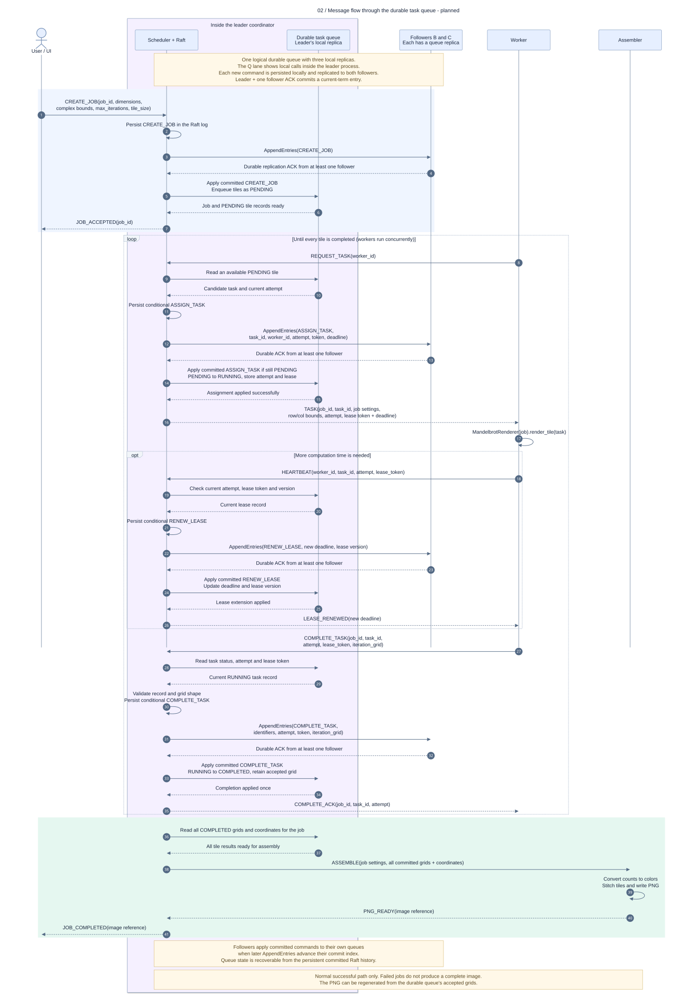
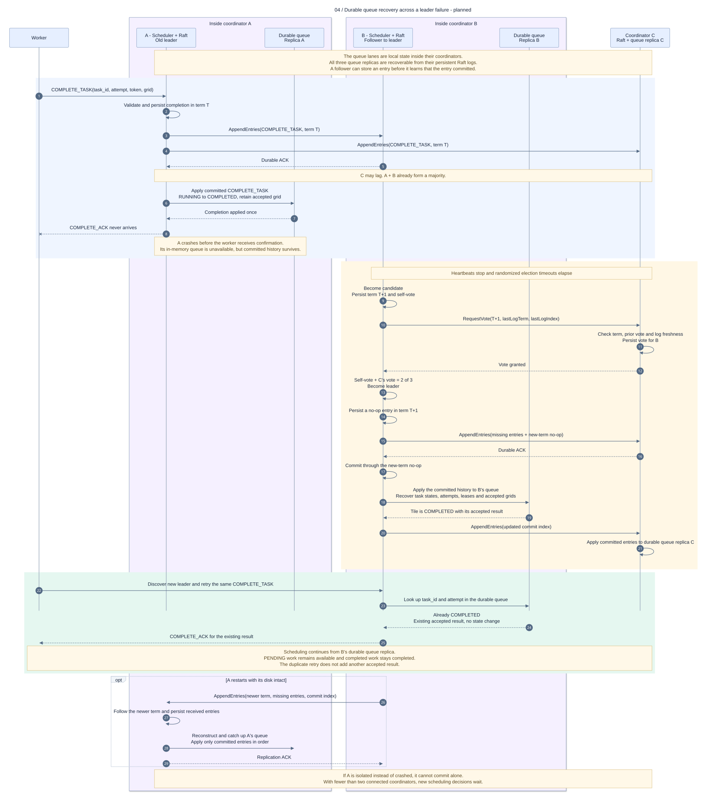

# Mandelbrot-fractals-render-farm
A Distributed Rendering Farm with Failure Recovery

## Architecture diagrams

These diagrams describe the **planned distributed system**. The current Python
implementation contains `MandelbrotRenderer`, which is still under development.
Coordinators, Raft, workers, leases, the web UI and image assembly are planned.
Message names describe a proposed protocol, not an implemented API.

The first milestone uses one coordinator and two workers. The diagrams show the
later architecture with three Raft coordinators and a configurable worker pool.

| Diagram | Scalable image | PNG image | Edit Mermaid source |
| --- | --- | --- | --- |
| 1. System architecture | [SVG](docs/diagrams/01-architecture.svg) | [PNG](docs/diagrams/01-architecture.png) | [Source](docs/diagrams/01-architecture.mmd) |
| 2. Normal message flow | [SVG](docs/diagrams/02-job-sequence.svg) | [PNG](docs/diagrams/02-job-sequence.png) | [Source](docs/diagrams/02-job-sequence.mmd) |
| 3. Worker failure recovery | [SVG](docs/diagrams/03-worker-recovery.svg) | [PNG](docs/diagrams/03-worker-recovery.png) | [Source](docs/diagrams/03-worker-recovery.mmd) |
| 4. Raft leader failover | [SVG](docs/diagrams/04-leader-failover.svg) | [PNG](docs/diagrams/04-leader-failover.png) | [Source](docs/diagrams/04-leader-failover.mmd) |

### 1. System architecture

The **durable task queue** is now drawn explicitly inside each coordinator. It
is one logical queue with three local replicas, not a separate broker or a
fourth server. Each replica holds pending, running, completed and failed tile
records, including attempts, leases and accepted results. The scheduler reads
its local queue; Raft replicates the commands that change it.

Each coordinator has its own persistent log and applies committed commands to
its queue replica. The in-memory queue is recoverable from that committed log
history; a Python collection alone is not durable. Replicas can temporarily lag
and agree after applying the same committed history. The assembler is one
logical role and can run alongside the leader rather than on a separate server.
Replicating full tile grids intentionally limits the initial version to small jobs.



### 2. Normal message flow

The **Durable task queue** lane is the leader's local queue replica. Arrows
between that lane and the scheduler are local reads and state-machine calls,
not network messages to another service. Followers apply the same commands to
their own queue replicas when they learn which entries are committed.

The diagram explicitly shows enqueueing new tiles as `PENDING`, reading pending
work, applying assignments as `RUNNING`, updating leases, storing accepted
results as `COMPLETED`, and reading completed grids for assembly. Queue writes
are applied only after Raft commitment.

Workers pull tiles and return iteration grids. Job settings contain `width`,
`height`, `real_min`, `real_max`, `imag_min`, `imag_max`, and `max_iterations`.
Tile coordinates use `row_start`, `row_end`, `col_start`, and `col_end`; end bounds
are exclusive and coordinates refer to the full image. Grid dimensions must
match those bounds. Python `None` is encoded as JSON `null` for pixels that do
not escape within the iteration limit.

The leader acknowledges assignments, results and any lease extension only after
commitment. Worker heartbeats are separate from Raft heartbeats. A liveness-only
heartbeat need not change replicated state; a lease renewal does.



### 3. Worker failure recovery

All task statuses shown belong to the **durable task queue**. After committed
expiration, unfinished work is re-enqueued as `PENDING`, or retained as `FAILED`
when the attempt limit is reached. The next assignment updates the same queue
record with a new attempt and lease token.

The leader proposes expiration; followers never change task state using their
own clocks. Commands check the current attempt, token and, for expiration, the
observed lease version when they are applied. This makes races with completion
or renewal deterministic. A matching retry of an accepted completion returns
the existing acknowledgment; an obsolete attempt cannot replace the result.

An expired attempt becomes pending again or enters the durable failed-task list
if the configured attempt limit is reached. The exact lease duration and retry
limit are configuration choices. Wall-clock timeout detection is only a trigger
for a proposal; committed state transitions determine which result is accepted.
Lease timing across a leader change still needs an explicit implementation policy.



### 4. Raft leader failover

This scenario crashes the leader after it commits a tile completion and applies
it to **durable queue replica A**, but before the worker receives its
acknowledgment. The new leader applies the committed history to **replica B**
and reads that replica to recognize the duplicate. The queue stays consistent
with the accepted result and the retry does not add another completed tile.
The new leader commits a no-op in its own term to establish the committed
history before acknowledging the retry. Pending work, attempts, leases and
accepted grids are preserved in the queue state. The PNG can be rebuilt from
those accepted grids.



Three coordinators require a majority of two for progress. A leader's new
current-term entry can commit with its own durable copy and one follower's;
the other follower may catch up later. Election, log freshness and commitment
rules follow the [Raft paper](https://raft.github.io/raft.pdf), sections 5.2-5.4.

### Editing and rendering

The `.mmd` files are editable text. Paste one into the
[Mermaid Live Editor](https://mermaid.live/) to preview it. The checked-in SVGs
open directly in a browser and do not require an editor extension.

The shared `docs/diagrams/mermaid-config.json` controls the exported appearance.
These exports were generated with Mermaid CLI 12.0.0. For PNG output, use a
`.png` output filename; `--size 2400` sets the maximum image dimension.
With [Mermaid CLI](https://github.com/mermaid-js/mermaid-cli) installed, run this
from the repository root for each source you change:

```sh
mmdc -i docs/diagrams/01-architecture.mmd -o docs/diagrams/01-architecture.svg -c docs/diagrams/mermaid-config.json -b white
```

Mermaid syntax references: [flowcharts](https://mermaid.js.org/syntax/flowchart.html)
and [sequence diagrams](https://mermaid.js.org/syntax/sequenceDiagram.html).
