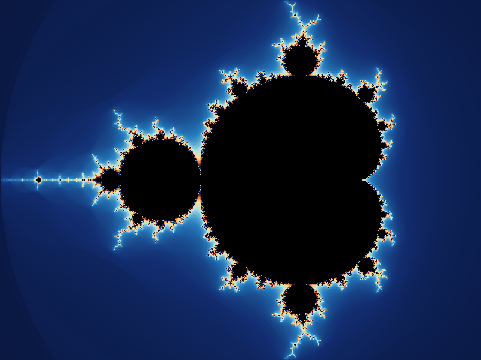

# Mandelbrot Fractals Render Farm

## What am I doing?

I am building a system that uses several worker processes to draw one
Mandelbrot image. I split the image into small rectangles called **tiles**.
Each worker calculates some tiles, then I put the results together into one image.

The main goal is to learn how to share work between workers and recover when
something fails. For example, if one worker stops halfway through, another
worker should finish its missing tiles. I should not need to start the whole
image again.

**The project is still in progress.** I am building the Python pieces first.
The networked workers, durable storage, Raft and full image output come later.

## What is a Mandelbrot image?

For each pixel, I choose a complex number `c` based on its position. I start
with `z = 0` and repeat this equation:

```text
z = z² + c
```

If `abs(z)` becomes greater than `2`, I stop and use the number of iterations
to choose a color. If it does not escape within my iteration limit, I color
that pixel black. This gives me a picture like this:



*This is a reference preview calculated from the example settings below. It
shows the kind of image I want to produce; the distributed render farm is
still being built.*

Mandelbrot works well for this project because each pixel can be calculated
independently. Workers can calculate different parts of the same image without
waiting for each other's results. Larger images and higher iteration limits
give them more work to share.

## Example of user input

The user will choose the image size, the area to draw and the iteration limit.
Here is an example job in JSON. These are the field names my Python classes
already use; submitting a job through a form or API is planned.

```json
{
  "width": 800,
  "height": 600,
  "real_min": -2.0,
  "real_max": 1.0,
  "imag_min": -1.125,
  "imag_max": 1.125,
  "max_iterations": 100,
  "tile_size": 100
}
```

| Input | What it means |
| --- | --- |
| `width`, `height` | I want an image that is 800 pixels wide and 600 pixels high. |
| `real_min`, `real_max` | The left and right edges of the area I want to draw. |
| `imag_min`, `imag_max` | The bottom and top edges of that area. Changing these bounds lets me zoom in. |
| `max_iterations` | I repeat the equation at most 100 times for each pixel. A higher limit can show more detail near the boundary, but takes more work. |
| `tile_size` | I split the image into tiles of up to 100 × 100 pixels. This can be a system setting with a default. |

## How will I handle this input?

1. **Check the input.** The coordinator will check that the image dimensions
   are integers greater than 1, the tile size and iteration limit are positive
   integers, and each minimum bound is smaller than its maximum.
2. **Split the image.** `TileGenerator` turns this 800 × 600 image into
   **48 tiles**: 8 across and 6 down. Each tile gets an ID and pixel bounds.
   If the image size does not divide evenly, the edge tiles are smaller.
3. **Queue the work.** Each tile starts as `PENDING`. The coordinator tracks
   its status, assigned worker, attempts and result. My current `Task` class
   keeps this in memory; the planned durable queue will recover it from disk
   after a restart.
4. **Give tiles to workers.** A worker asks for work. The coordinator assigns
   a tile and marks it `RUNNING`. The worker uses the job settings and the
   tile's position in the full image to calculate its pixels.
5. **Collect results and recover unfinished work.** A worker sends back a grid
   of iteration counts. The coordinator checks the result and marks the tile
   `COMPLETED`. If a worker stops responding, its unfinished tile can go back
   into the queue for another worker. If it reaches the retry limit, I mark
   it `FAILED` and report the failure.
6. **Build the final image.** When all tiles are completed, the assembler
   converts the counts into colors and places each tile in its correct
   position. The user gets one 800 × 600 PNG image.

For example, the first tile generated from this input is:

```json
{
  "task_id": 0,
  "row_start": 0,
  "row_end": 100,
  "col_start": 0,
  "col_end": 100
}
```

This means rows 0–99 and columns 0–99: the top-left 100 × 100 pixels.
The end values are excluded, so neighboring tiles do not overlap. The worker
also needs the shared job settings above; the tile only describes its part
of the image.

## Why a durable queue and Raft?

The **durable queue** remembers what still needs to be done and what has
already finished, even after a restart. A Python queue in memory alone cannot
do that.

For the later version, I plan to use **three coordinators with Raft**. One is
the leader and handles assignments. Raft keeps their saved task history in
agreement, so if the leader fails, another coordinator can take over using
the saved work. At least two of the three must be available to make progress.

This is one logical durable queue with a copy inside each coordinator. I am
not adding a separate queue server. Raft will confirm queue changes before
the leader sends an assignment or acknowledges a completed result.

## What have I built so far?

- [`MandelbrotRenderer`](renderer/mandelbrot.py): the equation, pixel mapping
  and a tile-rendering method. This part is still being corrected and tested.
- [`TileGenerator`](tile_generator/tile_generator.py): splits image dimensions
  into tiles, including smaller tiles at the edges.
- [`Task`](task/task.py): keeps an in-memory queue and tracks assignments,
  results, retries and failed tasks.
- [`Tests`](Tests): simple assertion tests for the renderer and task queue.
  These do not yet test a complete distributed render.

My first distributed milestone is **one coordinator and two workers**, with
a demonstration where I stop one worker and still finish the image. After
that, I will add durable storage and recovery across coordinator failures.

## Architecture diagrams

These diagrams describe the **planned distributed system**. The current Python
pieces are listed above. Networked coordinators and workers, durable storage,
Raft, leases, the web UI and image assembly are planned.
Message names describe a proposed protocol, not an implemented API.

The first milestone uses one coordinator and two workers. The diagrams show the
later architecture with three Raft coordinators and a configurable worker pool.

| Diagram | Scalable image | PNG image | Edit Mermaid source |
| --- | --- | --- | --- |
| 1. System architecture | [SVG](docs/diagrams/01-architecture.svg) | [PNG](docs/diagrams/01-architecture.png) | [Source](docs/diagrams/01-architecture.mmd) |
| 2. Normal message flow | [SVG](docs/diagrams/02-job-sequence.svg) | [PNG](docs/diagrams/02-job-sequence.png) | [Source](docs/diagrams/02-job-sequence.mmd) |
| 3. Worker failure recovery | [SVG](docs/diagrams/03-worker-recovery.svg) | [PNG](docs/diagrams/03-worker-recovery.png) | [Source](docs/diagrams/03-worker-recovery.mmd) |
| 4. Raft leader failover | [SVG](docs/diagrams/04-leader-failover.svg) | [PNG](docs/diagrams/04-leader-failover.png) | [Source](docs/diagrams/04-leader-failover.mmd) |

### 1. System architecture

The **durable task queue** is now drawn explicitly inside each coordinator. It
is one logical queue with three local replicas, not a separate broker or a
fourth server. Each replica holds pending, running, completed and failed tile
records, including attempts, leases and accepted results. The scheduler reads
its local queue; Raft replicates the commands that change it.

Each coordinator has its own persistent log and applies committed commands to
its queue replica. The in-memory queue is recoverable from that committed log
history; a Python collection alone is not durable. Replicas can temporarily lag
and agree after applying the same committed history. The assembler is one
logical role and can run alongside the leader rather than on a separate server.
Replicating full tile grids intentionally limits the initial version to small jobs.


### 2. Normal message flow

The **Durable task queue** lane is the leader's local queue replica. Arrows
between that lane and the scheduler are local reads and state-machine calls,
not network messages to another service. Followers apply the same commands to
their own queue replicas when they learn which entries are committed.

The diagram explicitly shows enqueueing new tiles as `PENDING`, reading pending
work, applying assignments as `RUNNING`, updating leases, storing accepted
results as `COMPLETED`, and reading completed grids for assembly. Queue writes
are applied only after Raft commitment.

Workers pull tiles and return iteration grids. Job settings contain `width`,
`height`, `real_min`, `real_max`, `imag_min`, `imag_max`, and `max_iterations`.
Tile coordinates use `row_start`, `row_end`, `col_start`, and `col_end`; end bounds
are exclusive and coordinates refer to the full image. Grid dimensions must
match those bounds. Python `None` is encoded as JSON `null` for pixels that do
not escape within the iteration limit.

The leader acknowledges assignments, results and any lease extension only after
commitment. Worker heartbeats are separate from Raft heartbeats. A liveness-only
heartbeat need not change replicated state; a lease renewal does.


### 3. Worker failure recovery

All task statuses shown belong to the **durable task queue**. After committed
expiration, unfinished work is re-enqueued as `PENDING`, or retained as `FAILED`
when the attempt limit is reached. The next assignment updates the same queue
record with a new attempt and lease token.

The leader proposes expiration; followers never change task state using their
own clocks. Commands check the current attempt, token and, for expiration, the
observed lease version when they are applied. This makes races with completion
or renewal deterministic. A matching retry of an accepted completion returns
the existing acknowledgment; an obsolete attempt cannot replace the result.

An expired attempt becomes pending again or enters the durable failed-task list
if the configured attempt limit is reached. The exact lease duration and retry
limit are configuration choices. Wall-clock timeout detection is only a trigger
for a proposal; committed state transitions determine which result is accepted.
Lease timing across a leader change still needs an explicit implementation policy.


### 4. Raft leader failover

This scenario crashes the leader after it commits a tile completion and applies
it to **durable queue replica A**, but before the worker receives its
acknowledgment. The new leader applies the committed history to **replica B**
and reads that replica to recognize the duplicate. The queue stays consistent
with the accepted result and the retry does not add another completed tile.
The new leader commits a no-op in its own term to establish the committed
history before acknowledging the retry. Pending work, attempts, leases and
accepted grids are preserved in the queue state. The PNG can be rebuilt from
those accepted grids.


Three coordinators require a majority of two for progress. A leader's new
current-term entry can commit with its own durable copy and one follower's;
the other follower may catch up later. Election, log freshness and commitment
rules follow the [Raft paper](https://raft.github.io/raft.pdf), sections 5.2-5.4.

### Editing and rendering

The `.mmd` files are editable text. Paste one into the
[Mermaid Live Editor](https://mermaid.live/) to preview it. The checked-in SVGs
open directly in a browser and do not require an editor extension.

The shared `docs/diagrams/mermaid-config.json` controls the exported appearance.
These exports were generated with Mermaid CLI 12.0.0. For PNG output, use a
`.png` output filename; `--size 2400` sets the maximum image dimension.
With [Mermaid CLI](https://github.com/mermaid-js/mermaid-cli) installed, run this
from the repository root for each source you change:

```sh
mmdc -i docs/diagrams/01-architecture.mmd -o docs/diagrams/01-architecture.svg -c docs/diagrams/mermaid-config.json -b white
```

Mermaid syntax references: [flowcharts](https://mermaid.js.org/syntax/flowchart.html)
and [sequence diagrams](https://mermaid.js.org/syntax/sequenceDiagram.html).
